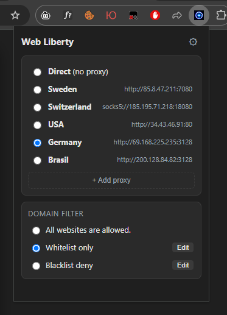
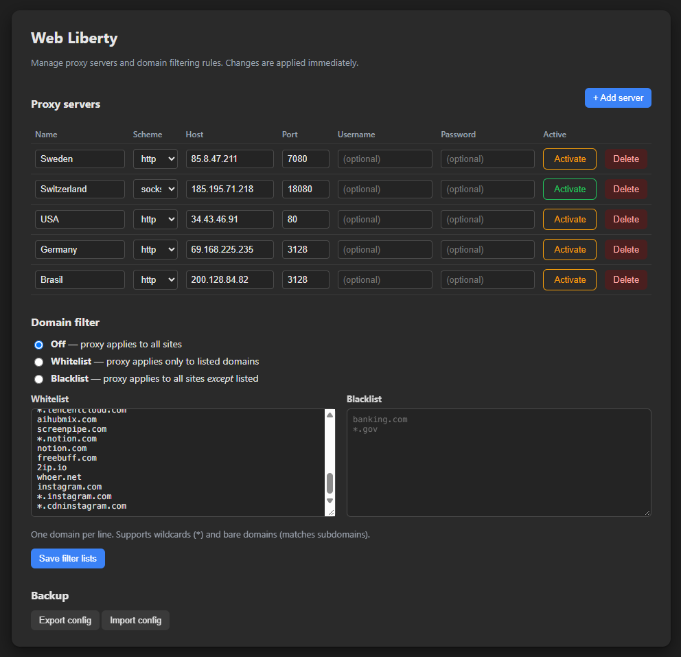

**Languages:** [Русский](README.md) | [English](README-EN.md) 

# Web Liberty (Chrome and Firefox Extension)

Manage multiple SOCKS5 / SOCKS4 / HTTP / HTTPS proxies and switch between them with one click. Optional per-domain whitelist/blacklist routing. Light/dark theme follows the OS.

## Features

- Add unlimited proxy profiles (`socks5`, `socks4`, `http`, `https`).
- One-click switch between profiles or **Direct** (no proxy).
- Optional credentials for HTTP(S) proxies (auto-supplied via `webRequest.onAuthRequired`).
- Domain filtering modes:
  - **All websites are allowed** — proxy is used for all sites.
  - **Whitelist only** — proxy is used **only** for listed domains.
  - **Blacklist deny** — proxy is used for everything **except** listed domains.
- Toolbar icon reflects current state (on/off); no badge text clutter.
- Light/dark theme follows the OS color scheme.
- Domain patterns support bare domains (subdomain match) and `*` wildcards, e.g. `example.com`, `*.github.com`, `*google*`.
- Local/private addresses (RFC1918, loopback, `*.local`) always go direct.
- Export / import your configuration as JSON.

## Installation

Download the repository (**Code → Download ZIP** on GitHub) and unzip it. Each browser has its own folder: `chrome/` and `firefox/`. Follow the instructions for your browser.

### Chrome (unpacked)

1. Copy the contents of the `chrome/` folder to a permanent location, for example: `C:\Users\<YOUR_NAME>\Documents\Chrome Extensions\WebLiberty`. Do not delete or move this folder after installing: Chrome loads the extension files directly from it.
2. Open `chrome://extensions/`.
3. Enable **Developer mode** (top-right).
4. Click **Load unpacked** and select the `WebLiberty` folder.
5. Pin the extension. Click the icon → ⚙ to open settings.

### Firefox (version 140 or newer)

1. Download `web-liberty.xpi` from the `firefox/` folder.
2. Open `about:addons`, click the gear icon → **Install Add-on From File…** and select the downloaded `.xpi`. You can also drag the file into the Firefox window.
3. Confirm the requested permissions.
4. Pin the extension to the toolbar. Click the icon → ⚙ to open settings.

By default, Firefox does not run extensions in private windows. If you need that, allow it in the extension's settings on the `about:addons` page.

## Usage

The extension works the same way in Chrome and Firefox.

1. **Popup**: pick the active server or **Direct**. Use **+ Add proxy** to jump to the settings page and create one. The **Edit** buttons next to *Whitelist only* / *Blacklist deny* open the corresponding domain list.
2. **Settings page**: add one or more proxy servers (name, scheme, host, port, optional username/password). The **Active** radio in the table marks which profile is currently applied; leaving all unchecked equals Direct.
3. **Domain filter**: choose mode and edit the domain lists. Bare domains match subdomains; `*` wildcard is supported.

## Notes on schemes

- `socks5` — in Chrome, DNS may be resolved remotely by the proxy depending on the browser's policy; in Firefox, names are always resolved on the proxy side.
- `socks4` — auth not supported by SOCKS4.
- `http` / `https` — username/password are sent automatically when the proxy challenges with `407`.
